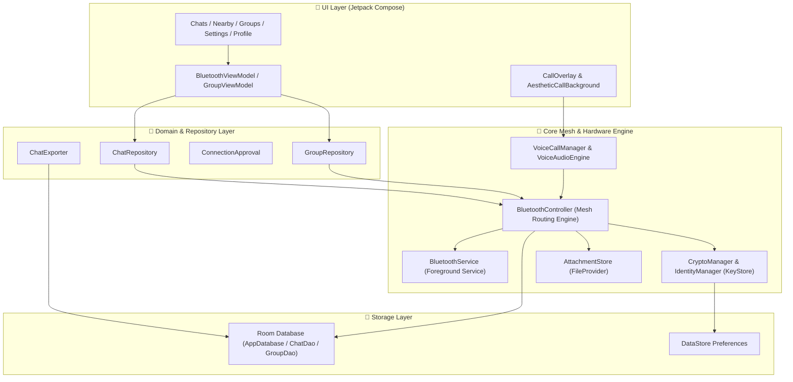
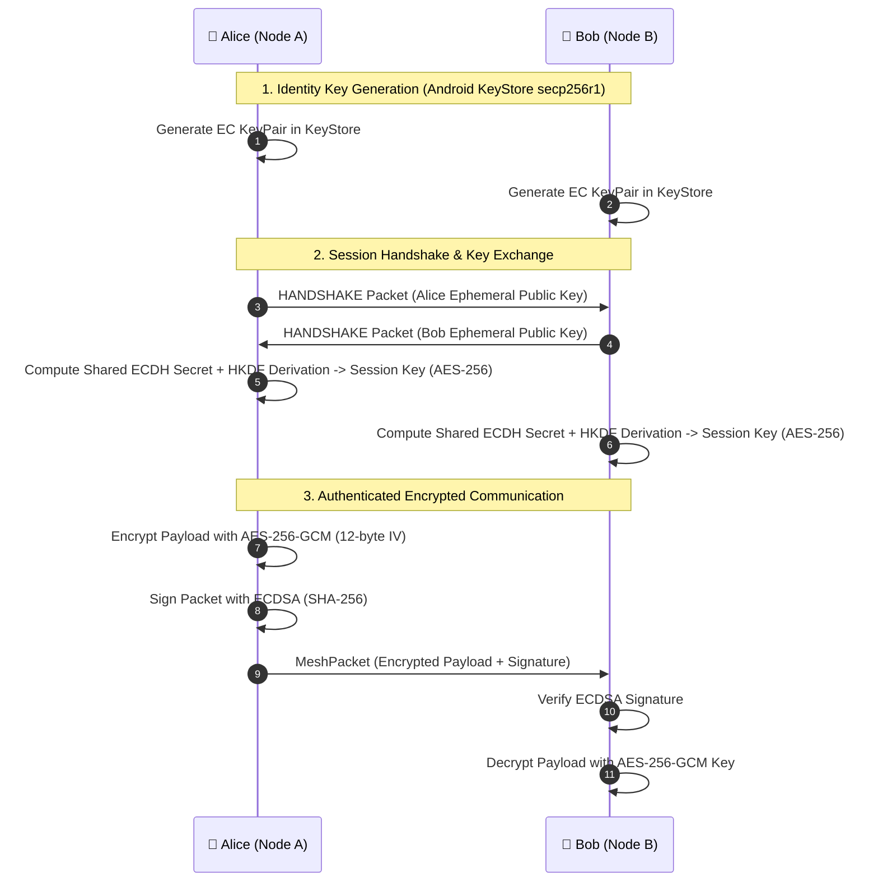

# 🌐 OffGridChat

[](https://developer.android.com)
[](https://kotlinlang.org/)
[](https://developer.android.com/jetpack/compose)
[](https://dagger.dev/hilt/)
[](https://developer.android.com/training/articles/keystore)
[](https://developer.android.com/guide/topics/connectivity/bluetooth)

**OffGridChat** is an advanced, fully decentralized, peer-to-peer (P2P) offline mesh messaging and encrypted real-time voice calling application for Android. It operates with **zero cellular coverage, zero internet connection, and zero central servers**. 

By leveraging raw Bluetooth (RFCOMM / BLE discovery) to construct an ad-hoc, multi-hop mesh network, OffGridChat allows nearby and multi-hop distant devices to exchange end-to-end encrypted text messages, images, voice notes, files, and perform live encrypted voice calls.

---

## 🚀 Key Features

### 📡 Decentralized Multi-Hop Bluetooth Mesh Networking
- **Zero Infrastructure Required**: Operates completely offline during emergencies, remote outdoor expeditions, natural disasters, or grid blackouts.
- **Multi-Hop Store & Forward Routing**: Packets traverse intermediate peers using Time-To-Live (TTL) scoping and adaptive route tables to reach nodes beyond direct line-of-sight.
- **Automated Link Discovery & Reconnection**: Continuous background peer scanning and dynamic socket recovery over Bluetooth RFCOMM channels.

### 🔐 Military-Grade End-to-End Cryptography
- **Elliptic Curve Key Exchange (ECDH)**: Uses `secp256r1` curve keys stored securely inside the hardware-backed **Android KeyStore**.
- **Authenticated Symmetric Encryption**: All direct messages, media attachments, and live voice data streams are encrypted using **AES-256-GCM** with unique IVs.
- **Cryptographic Packet Signatures**: Packets are signed with **ECDSA** (SHA-256) to ensure strict authenticity and prevent packet spoofing or tampering.
- **Cryptographic Identity Verification**: Users verify contacts using short (8-char) or full 64-character cryptographic SHA-256 fingerprints.

### 🎙️ Real-Time Encrypted Offline Voice Calling
- **Low-Latency Peer-to-Peer Calls**: Live PCM audio streaming directly over dedicated Bluetooth sockets.
- **Hardware-Accelerated Audio Processing**: Integrated Android `AcousticEchoCanceler` and `NoiseSuppressor` for crystal-clear voice clarity.
- **Bounded Jitter Queues**: Prevents accumulating conversational latency by shedding delayed audio frames.
- **Aesthetic Call UI**: Glassmorphic overlay (`AestheticCallBackground`) with gradient glow, radial canvas accents, and in-call controls (Mute, Speakerphone, Hold, Hang up).

### 💬 Rich Media & Group Communication
- **Offline Media & File Attachments**: Transmit compressed images, audio recordings, and documents over chunked mesh data streams.
- **Encrypted Group Channels**: Create multi-peer group chats with encrypted payload envelopes (`GroupEnvelope`) and member authorization lists.
- **Message Delivery & Read Receipts**: Real-time transmission status (Sending, Sent, Delivered, Read) across the mesh network.

### 🛡️ Privacy, Safety & Control
- **Connection Approval System**: Mutual pairing requests allow users to explicitly accept or block incoming peer connections before accepting data packets.
- **Anti-Spam & Rate Limiting**: Automatic dropping of unauthorized packets, duplicate IDs, or expired TTLs.
- **Comprehensive Chat Backup & Export**: Export chat threads into plaintext (`.txt`), structured (`.json`), or full `.zip` archives including media attachments.

### 🎨 Modern Glassmorphism UI
- **Built with 100% Jetpack Compose & Material 3**.
- **Liquid Visual Effects & Blur**: Utilizes `Haze` blur modifiers, frosted glass cards, adaptive light/dark mode themes (`LocalOgColors`), and dynamic animations.

---

## 🛠️ Technology Stack

| Layer | Technology | Description |
| :--- | :--- | :--- |
| **Language** | [Kotlin](https://kotlinlang.org/) (100%) | Modern, safe, coroutines-first Android programming |
| **UI Framework** | [Jetpack Compose](https://developer.android.com/jetpack/compose) | Declarative UI with Material 3 components |
| **Visual Effects** | [Chris Banes Haze](https://github.com/chrisbanes/haze) | Real-time GPU blur and glassmorphism rendering |
| **Architecture** | Clean Architecture / MVVM | Modular separation of UI, Repository, Domain, and Core services |
| **Dependency Injection** | [Hilt / Dagger](https://dagger.dev/hilt/) | Compile-time dependency injection |
| **Local Database** | [Room Database](https://developer.android.com/training/data-storage/room) | KSP-processed SQLite persistence for messages, routes, & peers |
| **Preferences** | [DataStore Preferences](https://developer.android.com/topic/libraries/architecture/datastore) | Asynchronous key-value settings storage |
| **Networking** | Bluetooth RFCOMM / Classic Sockets | Raw Bluetooth P2P packet transmission protocol |
| **Security** | Android KeyStore + Java Crypto | ECDH (`secp256r1`), AES-256-GCM, ECDSA (`SHA256withECDSA`), HKDF |
| **Audio Engine** | `AudioRecord` + `AudioTrack` | Low-latency audio sampling with `AcousticEchoCanceler` & `NoiseSuppressor` |
| **Image Loading** | [Coil Compose](https://coil-kt.github.io/coil/) | Asynchronous image decoding and caching |

---

## 🏗️ System Architecture

OffGridChat strictly follows Clean Architecture and MVVM principles powered by Hilt dependency injection.



---

## 📜 Mesh Protocol Specification

All communication across the OffGridChat mesh uses structured JSON payloads encapsulated inside a `MeshPacket`.

### 📦 Mesh Packet Structure

```json
{
  "v": 1,
  "id": "550e8400-e29b-41d4-a716-446655440000",
  "src": "a1b2c3d4e5f6...",
  "dst": "f6e5d4c3b2a1...",
  "prev": "b2c3d4e5f6a1...",
  "ttl": 7,
  "type": "CHAT",
  "ts": 1718000000000,
  "payload": "Base64EncryptedCiphertextOrJson",
  "srcName": "Alice",
  "srcPubKey": "3059301306072a8648ce3d0201...",
  "ackId": "optional-message-id-for-ack",
  "enc": true,
  "encVer": 1,
  "sig": "3045022100a89f..."
}
```

### 🏷️ Packet Types (`PacketType`)

| Packet Type | Purpose |
| :--- | :--- |
| `CHAT` | Standard end-to-end encrypted direct text/media message |
| `ACK` | Acknowledgement receipt confirming packet delivery or read status |
| `HANDSHAKE` | Session key exchange request/response (`SessionHandshake`) |
| `DISCOVERY` | Peer presence broadcast and route discovery beacon |
| `VOICE_INIT` | Voice call invitation request |
| `VOICE_ACCEPT` | Voice call session acceptance and port setup |
| `VOICE_DATA` | Low-latency real-time voice audio payload (PCM) |
| `VOICE_END` | Call termination signal |
| `GROUP_CHAT` | Multi-peer group envelope payload |
| `ATTACHMENT_CHUNK` | Binary chunk for file/image transmission |

---

## 🔒 Cryptographic Handshake & Encryption Pipeline



---

## 📂 Project Structure

```
OffGridChatApp/
├── app/
│   ├── build.gradle.kts                # Application dependencies and build configs
│   └── src/
│       ├── androidTest/                # Automated instrumentation tests
│       └── main/
│           ├── AndroidManifest.xml     # App permissions, activities, and foreground services
│           ├── java/com/saurabh/offgridchat/
│           │   ├── MainActivity.kt     # Entry point activity & Compose theme host
│           │   ├── attachments/        # File & image attachment management (AttachmentStore)
│           │   ├── calling/            # Voice call engine, audio hardware, & CallOverlay UI
│           │   │   ├── AestheticCallBackground.kt
│           │   │   ├── CallOverlay.kt
│           │   │   ├── VoiceAudioEngine.kt
│           │   │   └── VoiceCallManager.kt
│           │   ├── core/               # BluetoothController & mesh networking logic
│           │   ├── crypto/             # CryptoManager (AES-GCM, ECDH) & IdentityManager (KeyStore)
│           │   ├── database/           # Room Database, DAOs, and Entities
│           │   ├── datastore/          # Preferences & settings store
│           │   ├── di/                 # Hilt Modules (DatabaseModule)
│           │   ├── export/             # ChatExporter (TXT, JSON, ZIP archive generator)
│           │   ├── navigation/         # Navigation graph & routes
│           │   ├── protocol/           # MeshPacket, GroupEnvelope, SessionHandshake
│           │   ├── repository/         # ChatRepository, GroupRepository, ConnectionApproval
│           │   ├── screens/            # Jetpack Compose UI Screens
│           │   │   ├── ChatsScreen.kt
│           │   │   ├── ChatDetailScreen.kt
│           │   │   ├── GroupChatScreen.kt
│           │   │   ├── NearbyScreen.kt
│           │   │   ├── ProfileScreen.kt
│           │   │   ├── SettingsScreen.kt
│           │   │   └── SplashScreen.kt
│           │   ├── service/            # Foreground Bluetooth Mesh Service
│           │   ├── tools/              # Helper utilities & permissions helpers
│           │   └── ui/                 # Glassmorphic components & Material 3 Theme
│           └── res/                    # Drawables, mipmaps, XML paths, and app resources
└── README.md
```

---

## 📋 Android Permissions

OffGridChat requires hardware permissions to discover peers, manage Bluetooth mesh sockets, handle background routing, and record call audio:

| Permission | Purpose |
| :--- | :--- |
| `BLUETOOTH_SCAN` | Discover nearby mesh nodes (with `neverForLocation` flag on API 31+) |
| `BLUETOOTH_CONNECT` | Connect and exchange data sockets with nearby mesh nodes |
| `BLUETOOTH_ADVERTISE` | Broadcast node presence to allow nearby peers to discover this device |
| `FOREGROUND_SERVICE` | Keep the Bluetooth mesh engine active when the app is minimized |
| `FOREGROUND_SERVICE_CONNECTED_DEVICE` | Maintain active Bluetooth mesh socket connections in the background |
| `FOREGROUND_SERVICE_MICROPHONE` | Keep live encrypted voice calls active during background overlay usage |
| `RECORD_AUDIO` | Sample PCM microphone audio during encrypted voice calls |
| `ACCESS_FINE_LOCATION` | Required on legacy Android devices (API ≤ 30) for Bluetooth scanning |

---

## ⚙️ Setup & Installation

### Prerequisites
- **Android Studio**: Ladybug (2024.2.1+) or newer
- **JDK Version**: Java 17
- **Android SDK**: API level 35/37 (Min SDK: 26 / Android 8.0)
- **Hardware Requirements**: Two or more physical Android devices equipped with Bluetooth (Emulators cannot test physical Bluetooth sockets).

### Building from Source

1. **Clone the Repository**:
   ```bash
   git clone https://github.com/your-username/OffGridChatApp.git
   cd OffGridChatApp
   ```

2. **Open in Android Studio**:
   - Select **File > Open** and choose the `OffGridChatApp` folder.
   - Allow Gradle to sync dependencies.

3. **Build Debug APK**:
   ```bash
   ./gradlew assembleDebug
   ```

4. **Install on Physical Devices**:
   Connect physical Android devices via USB / Wireless ADB and run:
   ```bash
   ./gradlew installDebug
   ```

---

## 💻 How to Use

1. **Launch App & Grant Permissions**:
   Open OffGridChat on two or more physical Android devices and grant Bluetooth and Microphone permissions.
2. **Discover Nearby Nodes**:
   Navigate to the **Nearby** tab to view surrounding nodes automatically discovered via Bluetooth beacons.
3. **Connect & Pair**:
   Tap **Connect** on a peer. A mutual connection request popup will appear on the remote device. Once approved, session keys are derived via ECDH.
4. **Send Encrypted Messages & Attachments**:
   Open the chat thread to send instant encrypted messages, voice notes, or photos.
5. **Start an Offline Voice Call**:
   Tap the **Call** icon at the top right of a chat thread to initiate a real-time encrypted voice call over Bluetooth.
6. **Backup & Export**:
   Go to **Settings > Export Chat** to generate a local `.zip`, `.json`, or `.txt` backup of your conversation history.

---

## 🛡️ Security Audit & Privacy Guarantees

- 🚫 **No Analytics or Telemetry**: No tracking code or remote analytics SDKs.
- 🚫 **No Server Dependencies**: Zero API keys or cloud services required.
- 🔐 **Key Storage Integrity**: Private identity keys are stored inside the hardware-backed Android KeyStore and never leave the device.
- 🧹 **Local Data Ownership**: All conversation history and media are stored exclusively in your local Room database.

---

## 🤝 Contributing

Contributions are welcome! Please follow these steps:
1. Fork the repository.
2. Create a feature branch (`git checkout -b feature/mesh-optimization`).
3. Commit your changes (`git commit -m 'Add mesh routing optimization'`).
4. Push to the branch (`git push origin feature/mesh-optimization`).
5. Open a Pull Request detailing your changes and test results on physical hardware.

---

## 📄 License

```text
Copyright (c) 2025 Saurabh

Licensed under the Apache License, Version 2.0 (the "License");
you may not use this file except in compliance with the License.
You may obtain a copy of the License at

    http://www.apache.org/licenses/LICENSE-2.0

Unless required by applicable law or agreed to in writing, software
distributed under the License is distributed on an "AS IS" BASIS,
WITHOUT WARRANTIES OR CONDITIONS OF ANY KIND, either express or implied.
See the License for the specific language governing permissions and
limitations under the License.
```
